<div align="center">


# Google Pro Helper

A Chrome extension and a local macOS console for Google AI Pro account workflows.

**[Extension](#browser-extension)** · **[Batch console](#batch-console)** · **[Local data](#local-data)** · **[Source notes](#source-notes)**

</div>

## Choose your version

The two tools run independently, each in its own directory.

- **Browser extension** runs in Google Chrome. [Extension files](./extension/)
- **Batch console** runs on macOS 12+ with Chrome and Python 3.10+. [Batch files](./batch/)

> [!CAUTION]
> **Do not use your primary account.** The original source recommends using a secondary account.

> [!IMPORTANT]
> **“Two-year zero-cost” is the project's stated goal, not a verified result.** Free access, benefits, and actual charges depend on Google checkout and upstream results. Check the amount before confirming a subscription.

## Browser extension

### A look inside

_Screenshots follow your device's light or dark theme._

<p align="center">
  <picture>
    <source media="(prefers-color-scheme: dark)" srcset="./extension/docs/images/popup-offers-dark.png">
    <source media="(prefers-color-scheme: light)" srcset="./extension/docs/images/popup-offers-light.png">
    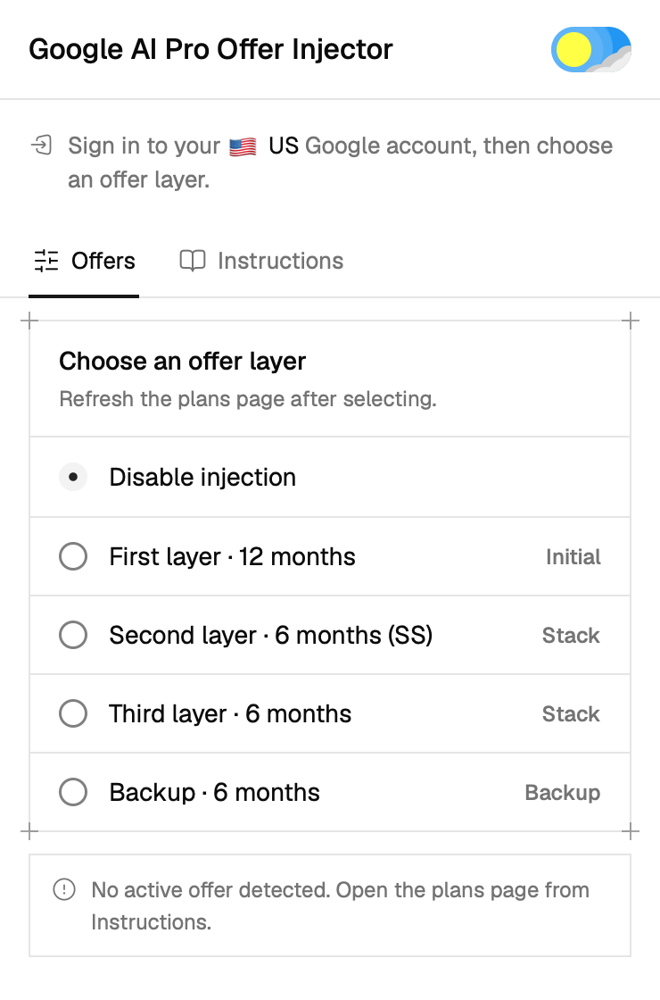
  </picture>
  <picture>
    <source media="(prefers-color-scheme: dark)" srcset="./extension/docs/images/popup-instructions-dark.png">
    <source media="(prefers-color-scheme: light)" srcset="./extension/docs/images/popup-instructions-light.png">
    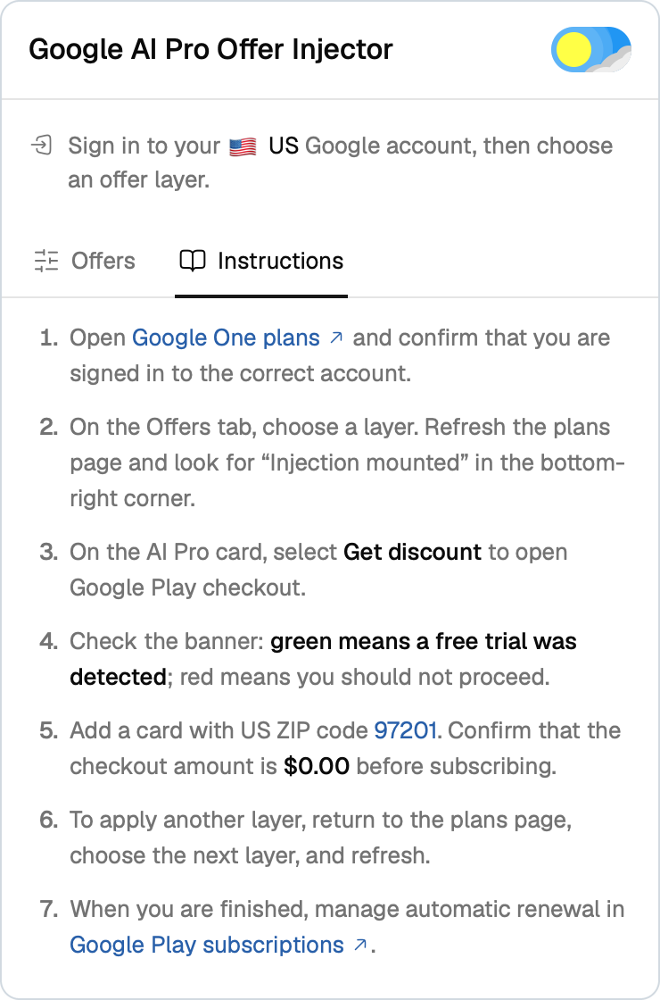
  </picture>
</p>

<p align="center"><sub><b>Offers</b> (left) · <b>Instructions</b> (right)</sub></p>

### Install

1. Open Chrome's **Extensions** page and enable **Developer mode**.
2. Click **Load unpacked** and select the [`extension`](./extension/) directory.
3. Open the extension popup.

### Use the popup

- **Offers:** select an offer layer, then refresh the plans page.
- **Instructions:** read the steps and open the relevant Google pages. Click **97201** to copy the ZIP code.
- **Theme switch:** toggle **Light / Dark**. Follows your system appearance until you save a preference.

Open [Google One plans](https://one.google.com/plans) and confirm that you are signed in to the intended US account. The original workflow starts with **12 months**; check the notice at the top and the status badge in the lower-right corner.

The source describes adding a payment card, applying further six-month layers, and cancelling automatic renewal. Its original steps, billing caveats, and community reports are preserved under [Source notes](#source-notes).

## Batch console

_Google AI Pro · 5 TB · stated goal: US$0.00 → 24 months_

### A look inside the console

_Screenshots follow your device's light or dark theme. All accounts and values shown are demo data._

#### Overview

<picture>
  <source media="(prefers-color-scheme: dark)" srcset="./batch/docs/images/console-overview-dark.png">
  <source media="(prefers-color-scheme: light)" srcset="./batch/docs/images/console-overview-light.png">
  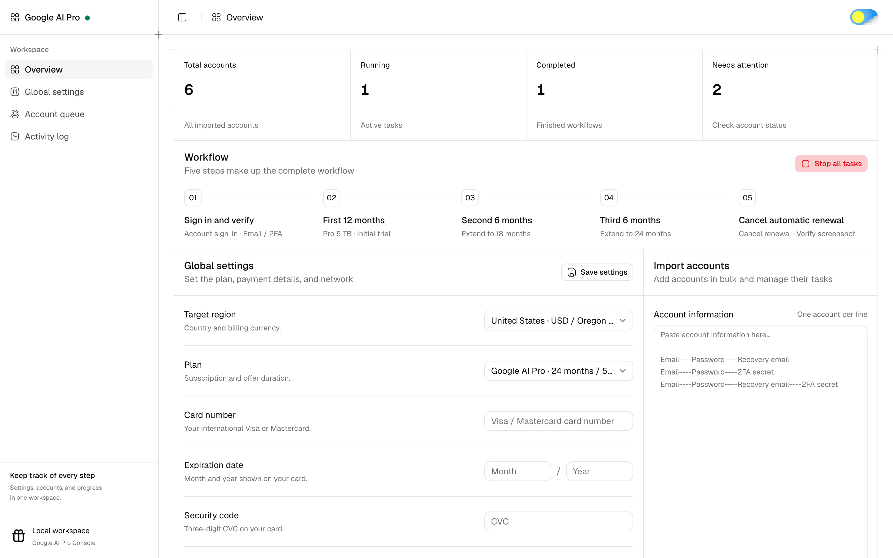
</picture>

#### Collapsed sidebar

<picture>
  <source media="(prefers-color-scheme: dark)" srcset="./batch/docs/images/console-sidebar-collapsed-dark.png">
  <source media="(prefers-color-scheme: light)" srcset="./batch/docs/images/console-sidebar-collapsed-light.png">
  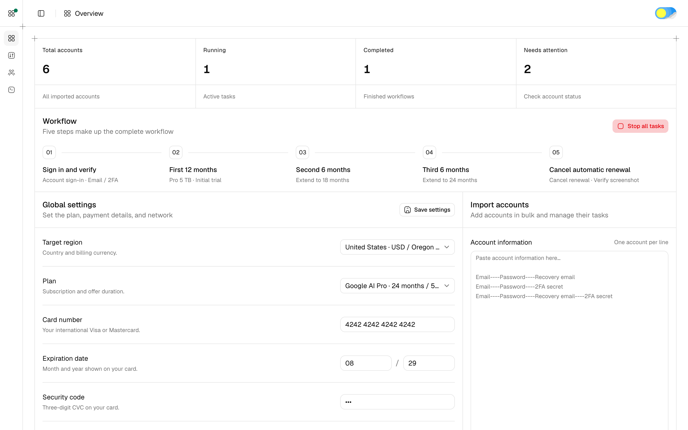
</picture>

#### Global settings and Import accounts

<p align="center">
  <picture>
    <source media="(prefers-color-scheme: dark)" srcset="./batch/docs/images/console-settings-filled-dark.png">
    <source media="(prefers-color-scheme: light)" srcset="./batch/docs/images/console-settings-filled-light.png">
    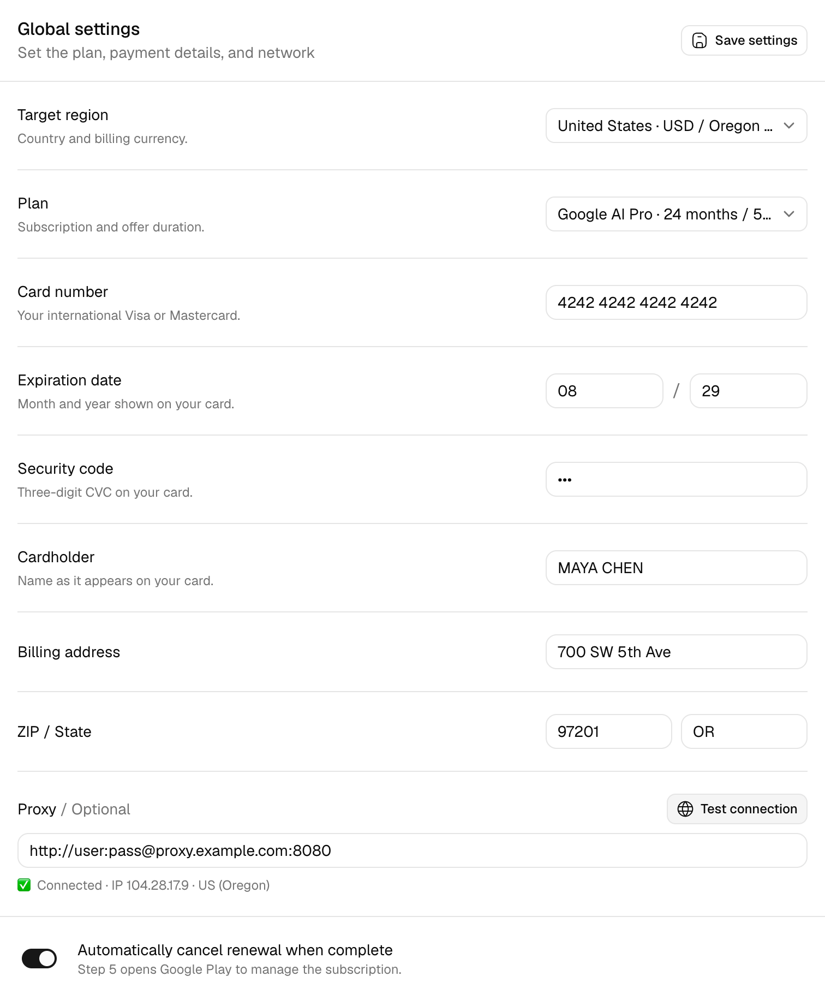
  </picture>
  <picture>
    <source media="(prefers-color-scheme: dark)" srcset="./batch/docs/images/console-import-dark.png">
    <source media="(prefers-color-scheme: light)" srcset="./batch/docs/images/console-import-light.png">
    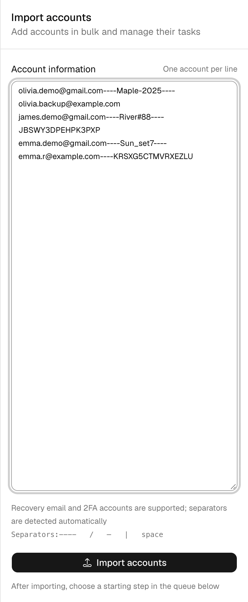
  </picture>
</p>

#### Target region

<picture>
  <source media="(prefers-color-scheme: dark)" srcset="./batch/docs/images/console-region-menu-dark.png">
  <source media="(prefers-color-scheme: light)" srcset="./batch/docs/images/console-region-menu-light.png">
  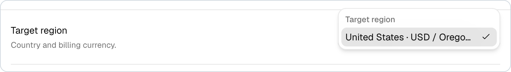
</picture>

#### Plan

<picture>
  <source media="(prefers-color-scheme: dark)" srcset="./batch/docs/images/console-plan-menu-dark.png">
  <source media="(prefers-color-scheme: light)" srcset="./batch/docs/images/console-plan-menu-light.png">
  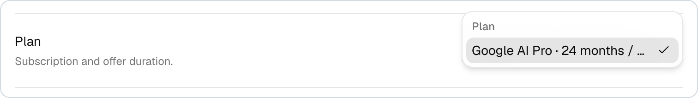
</picture>

#### Account queue

<picture>
  <source media="(prefers-color-scheme: dark)" srcset="./batch/docs/images/console-accounts-dark.png">
  <source media="(prefers-color-scheme: light)" srcset="./batch/docs/images/console-accounts-light.png">
  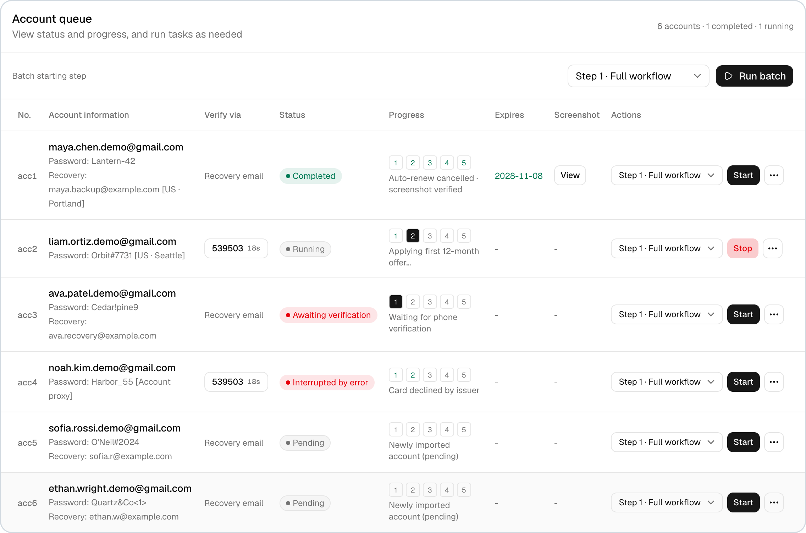
</picture>

#### Batch starting step

<picture>
  <source media="(prefers-color-scheme: dark)" srcset="./batch/docs/images/console-batch-step-menu-dark.png">
  <source media="(prefers-color-scheme: light)" srcset="./batch/docs/images/console-batch-step-menu-light.png">
  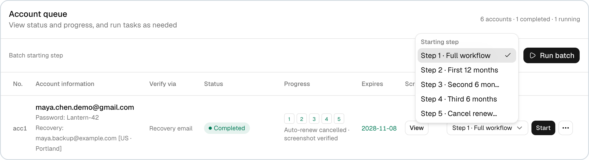
</picture>

#### Per-account starting step

<picture>
  <source media="(prefers-color-scheme: dark)" srcset="./batch/docs/images/console-row-step-menu-dark.png">
  <source media="(prefers-color-scheme: light)" srcset="./batch/docs/images/console-row-step-menu-light.png">
  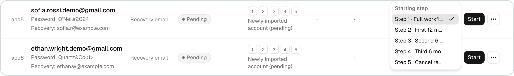
</picture>

#### Account actions

<picture>
  <source media="(prefers-color-scheme: dark)" srcset="./batch/docs/images/console-row-menu-dark.png">
  <source media="(prefers-color-scheme: light)" srcset="./batch/docs/images/console-row-menu-light.png">
  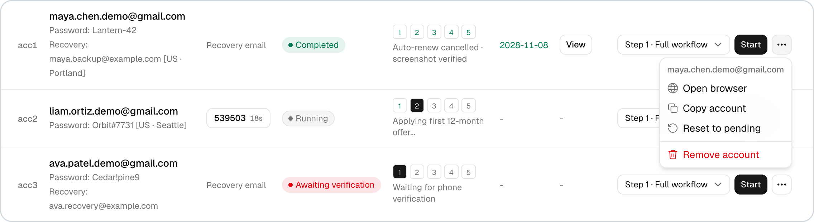
</picture>

#### Activity log

<picture>
  <source media="(prefers-color-scheme: dark)" srcset="./batch/docs/images/console-logs-dark.png">
  <source media="(prefers-color-scheme: light)" srcset="./batch/docs/images/console-logs-light.png">
  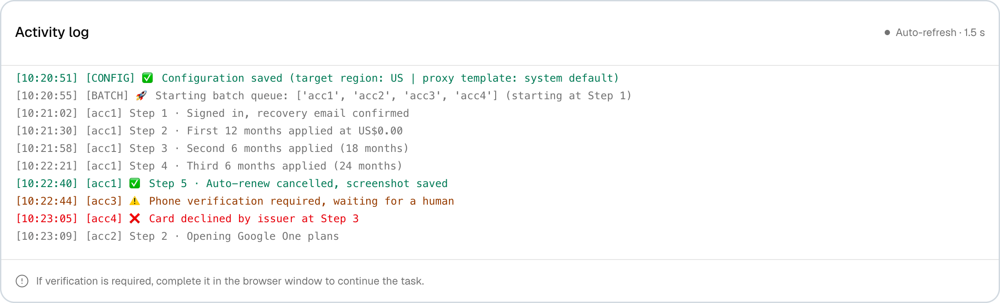
</picture>

### Requirements

- **System:** macOS 12 or later; the batch console targets macOS only.
- **Browser:** Google Chrome installed in its default location.
- **Python:** Python 3.10 or later.
- **Network:** a US proxy on your machine, or a proxy template entered in the console.

### Start the console

- **First run:** double-click [`1_install_and_start.command`](./batch/1_install_and_start.command).
- **Later runs:** double-click [`2_start_console.command`](./batch/2_start_console.command).

The browser opens the console at **[127.0.0.1:8765](http://127.0.0.1:8765)**. You can also open the `batch` directory and run the same launchers there.

### Configure payment details

In **Global settings**, enter your own international **Visa or Mastercard**, then click **Save settings**.

- **Card number:** 16 digits.
- **Expiration date:** month and year, such as `08 / 29`.
- **Security code:** 3-digit CVC.
- **Cardholder:** name in English.
- **Billing ZIP code:** preset to `97201`, Oregon, US; the original setup says no change is needed.

> [!NOTE]
> The script contains a **US$0.00 checkout guard** and is intended to click Subscribe only when the checkout dialog confirms that amount. This does **not** guarantee that no charges will occur; actual charges and benefits depend on checkout and upstream results.

### Import accounts

Paste **one account per line** into **Import accounts**. These formats are supported:

```text
email----password----recovery email
email----password----recovery email----2FA secret
email----password----2FA secret
```

Click **Import accounts**, then choose the starting step in the account queue.

### Run tasks

Click **Start** next to an account, or **Run batch** to process the queue. Use the **⋯** menu on a row to open its browser, copy the account, reset it to pending, or remove it.

1. **Sign in.** Sign in to Google and complete recovery-email or 2FA verification.
2. **First 12 months.** Set up a card with inline tax exemption and apply the first package, targeting US$0.00.
3. **Second 6 months.** Apply the next package, targeting US$0.00 and 18 months in total.
4. **Third 6 months.** Apply the final package, targeting US$0.00 and a 24-month cap.
5. **Cancel renewal.** Open Google Play, cancel automatic renewal, and capture a verification screenshot. The workflow aims to preserve the two-year benefit and verify its expiration.

## Local data

The first-run batch launcher creates a local **`.venv`**. Each account uses a separate browser profile directory. These are separate directories, _not a virtual machine or a security sandbox_.

> [!WARNING]
> **Keep sensitive data out of Git.** Account passwords, 2FA secrets, payment-card details, and browser login data are sensitive. Do not commit local configuration, browser profiles, screenshots, logs, or caches.

Local account and payment configuration (`config*.json`), environment files, caches, and runtime data are not committed to this repository. Enter batch configuration locally.

## Source notes

Original extension post: **[Linux.do · topic 3123997](https://linux.do/t/topic/3123997)**.

_The post describes free Google AI Pro activation for 12 or 24 months using offer-token injection. The following statements are attributed to that source and its commenters, rather than verified subscription results._

<details>
<summary><strong>Original workflow and billing notes</strong></summary>

The author says most of their accounts were created in bulk with a registration tool. They report that all seven remained active after half a month, but expect the offer may not last much longer if used at scale.

1. **Load the extension.** Enable Developer mode in Chrome and select **Load unpacked**.
2. **Start with 12 months.** Open [Google One plans](https://one.google.com/plans) and watch the green notice at the top and the notice in the lower-right corner.
3. **Select Pro and add a card.** The source says a card needs at least **US$1** available for verification and that the initial checkout should show **US$0 for the first month**.
4. **Apply another layer.** If the subscription page does not appear again, the source says not to worry or cancel the subscription, while also saying cancellation is okay. It instructs users to select six months in the extension, reopen the page, and switch to annual billing.
5. **Repeat for the remaining period.** The source says the subscription page should reappear and may show a payment date such as `2028-05-05`. It describes that date as the future payment date, says the period is still free, and proposes repeating the six-month steps to reach two years.
6. **Cancel automatic renewal.** The source warns that the bundle includes a monthly YouTube membership that may be billed the following month. Manage renewal in [Google Play subscriptions](https://play.google.com/store/account/subscriptions).

**Cards listed by the source as tested:** Starryblu, Maya, Bybit, MEXC, China Merchants Bank Mastercard, Bank of China 2233 Mastercard, BitEU, Wise, and Savo.

**Checkout caveat:** when a discount is already applied, the source warns that checkout may charge for the first month of YouTube membership. It says the normal display charges starting the following month.

</details>

<details>
<summary><strong>Community reports about account regions</strong></summary>

**Fy6666** reported this message:

> “YouTube Premium Individual Add On cannot be used. You can subscribe to other items in this bundle separately.”

They said they had looked it up and that YouTube membership was available only in the **US, Canada, Brazil, France, Germany, and Japan**.

**aikavvak12una** suggested adding a **US payment method** before subscribing if the account's region is wrong. They also said one of their secondary accounts had **China** as its terms region.

The post says to change the **Play Store payment method**, and says this is unrelated to the Google Account's country.

</details>

## Project layout

```text
google-pro-helper/
├── extension/        # Chrome extension
│   └── docs/images/  # Screenshots
├── batch/            # macOS batch console
│   └── docs/images/  # Screenshots
├── .gitignore
└── README.md
```
